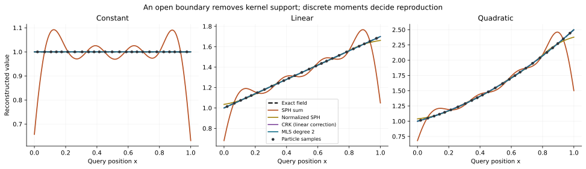
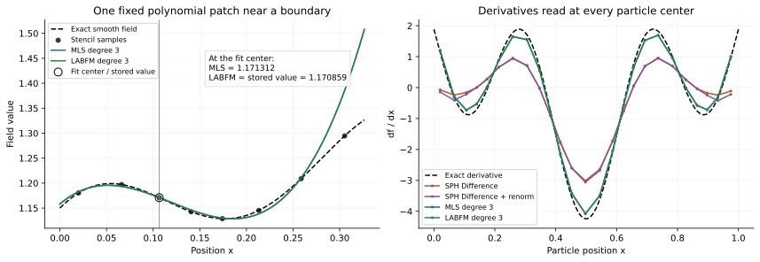
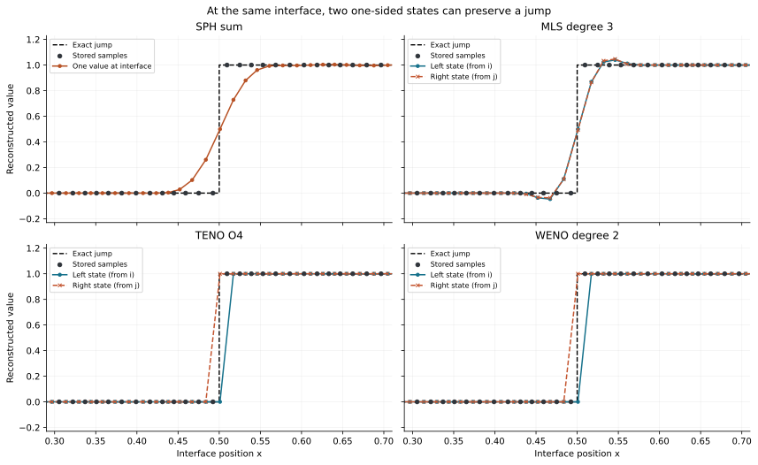
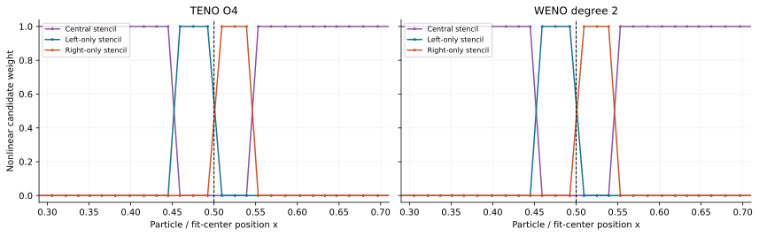

# How the schemes reconstruct a field

Particles store samples, not a continuous field. A reconstruction decides what
the field looks like between those samples, which derivatives to assign to it,
and what each side of a particle interaction should see. This guide compares
the production schemes in warpSPHCore, starting with the ordinary SPH sum.

The figures below come from the production CPU APIs in float64, using the
Wendland2 kernel and deterministic irregular particle clouds. They illustrate
capabilities and failure modes, not performance or a universal ranking.
The [API and numerical contracts](reconstruction.md) cover shapes,
differentiation, conditioning and supported configurations in more detail.

## Three different questions

For particle samples $(x_j,f_j)$, distinguish:

1. **A value at a location:** what is $f(x)$? SPH interpolation and MLS value
   evaluation answer this question.
2. **A derivative at a particle:** what is $\nabla f_i$? SPH gradient formulas,
   gradient renormalization and polynomial derivatives answer this question.
3. **Two states at an interface:** what does particle $i$ predict there, and
   what does particle $j$ predict there? Polynomial patches and TENO/WENO
   supply $f_L$ and $f_R$ for a downstream flux or Riemann solver.

Those answers need not coincide. A local polynomial can preserve the stored
center value while changing its slope. A corrected gradient can improve a
derivative without changing the interpolated value. Two accurate one-sided
states can intentionally disagree at a discontinuity.

| Scheme in this repo | What changes relative to an ordinary SPH sum? | What it directly supplies |
|---|---|---|
| Plain SPH | Uses volume-weighted kernel contributions | A smoothed value; separate SPH derivative operators |
| Normalized SPH / Shepard comparison | Divides the value sum by its weight sum | A constant-reproducing value where that sum is nonzero |
| CRK | Solves local moment constraints for corrected kernel weights | Constant/linear-reproducing values and a corrected kernel gradient on resolved stencils |
| Gradient renormalization | Corrects the response of a gradient operator to linear fields | A corrected derivative; no new field-value reconstruction |
| MLS/RKPM, `PolyFit(constant=True)` | Fits a polynomial including its constant coefficient | A fitted value, diffuse derivatives and an evaluable local patch |
| LABFM, `PolyFit(constant=False)` | Fits differences from the stored center value | An anchored local patch and diffuse derivatives |
| MLS-TENO | Selects a central polynomial or blends directional candidates using smoothness | Two nonlinear interface states |
| MLS-WENO | Continuously weights central/directional difference fits using smoothness | Two nonlinear interface states |

Here “standard SPH” means the uncorrected `WarpOperation.Interpolate` value
sum, together with explicitly named SPH gradient variants when discussing
derivatives. It does not mean every conservative SPH discretization or every
limiter used in a larger fluid solver.

## 1. Standard SPH: add overlapping kernel contributions

With reference volumes $V_j=m_j/\rho_j$, the ordinary value sum at query $x_i$ is

$$
\widetilde f_i=\sum_j V_j W_{ij}f_j.
$$

Think of every sample contributing a kernel-shaped bump, scaled by its value
and volume. Adding the bumps gives a continuous estimate as the query moves.
It usually smooths sharp changes. It need not pass through the stored samples.

A normalized continuum kernel does not automatically make a finite, irregular
particle sum normalized. Define its discrete moments using $r_{ij}=x_j-x_i$:

$$
S_0=\sum_j V_jW_{ij},\qquad S_1=\sum_j V_jW_{ij}r_{ij}.
$$

For a linear field $f_j=f_i+a\cdot r_{ij}$, the sum gives
$\widetilde f_i=f_iS_0+a\cdot S_1$. Constant reproduction needs $S_0=1$;
linear reproduction additionally needs $S_1=0$. Missing support at a boundary,
irregular spacing and the volume estimates can disturb these identities.



**Read the figure:** all methods use the same 25 particle locations, the same
support radius $h=5.5/25$, and the same reference apparent volumes from
`computeCRKFactors(reference_cloud)`. Queries span $[0,1]$, including the
boundary outside the outermost samples. Gather and Scatter are equivalent
here because every support is equal. The plain sum loses normalization near
the ends and has smaller interior quadrature errors. Curves overlap where
methods reproduce the same field.

Maximum absolute errors across the plotted queries make the overlapping
curves easier to compare:

| Field | SPH sum | Normalized SPH | CRK | MLS degree 2 |
|---|---|---|---|---|
| Constant | $0.369$ | $0$ | $4.44\times10^{-16}$ | $3.55\times10^{-15}$ |
| Linear | $0.651$ | $0.0383$ | $8.88\times10^{-16}$ | $7.11\times10^{-15}$ |
| Quadratic | $0.999$ | $0.122$ | $0.00415$ | $1.29\times10^{-14}$ |

These magnitudes belong to this deliberately truncated, irregular example;
they are not error bounds for the schemes.

The normalized comparison uses

$$
\widetilde f_i^{\mathrm{norm}}
=\frac{\sum_j V_jW_{ij}f_j}{\sum_j V_jW_{ij}}.
$$

It restores constants, but a one-sided neighborhood still has a nonzero first
moment, so linear fields remain biased. In the figure this is computed from
two production Interpolate calls, one on the field and one on ones. It is
**not** an automatic normalization option on `warpOperation`. A zero
denominator would require an explicit caller policy.

## 2. CRK: enforce the missing discrete moments

CRK changes the kernel weights themselves. Using the code's opposite offset
convention $x_{ij}=x_i-x_j$, it constructs

$$
\widehat W_{ij}=A_i(1+B_i\cdot x_{ij})W_{ij}
$$

so that, on a resolved augmented moment system,

$$
\sum_j V_j\widehat W_{ij}=1,\qquad
\sum_j V_j\widehat W_{ij}(x_j-x_i)=0.
$$

The coefficients compensate for asymmetry instead of assuming neighbors
balance. This explains why CRK reproduces the constant and linear examples
even at the boundary. The quadratic example retains a small curvature error:
these constraints do not enforce quadratic reproduction.

CRK is closely related to a degree-one MLS value fit: with the same weights,
support and a nonsingular moment matrix, the MLS equivalent shape functions
enforce these same linear reproduction constraints. The production APIs are
still different. CRK constructs corrected kernel factors and their spatial
derivatives; `PolyFit` constructs polynomial coefficients and reads local
polynomial derivatives.

The weights can become negative. Reproduction does not imply a bounded or
positive reconstruction. Degenerate geometry cannot supply missing spatial
directions; CRK uses its documented finite fallback instead. Construction and
consumption must use matching volumes, support rules and interaction filters.
In particular, `computeCRKFactors` uses apparent volumes, which need not equal
the caller's original $m/\rho$ volumes. See [CRK](crk/crk-overview.md).

## 3. Gradient renormalization: correct slopes, not values

The SPH Difference gradient is

$$
g_i^{\mathrm{SPH}}=\sum_j V_j(f_j-f_i)\nabla_i W_{ij}.
$$

It annihilates a constant field algebraically, without requiring a balanced
neighborhood. For a linear field, its answer is a moment matrix times the
true gradient. For an uncorrected radial kernel this matrix is symmetric:

$$
C_i=\sum_j V_j(x_j-x_i)\otimes\nabla_i W_{ij},\qquad
g_i^{\mathrm{corrected}}=C_i^{+}g_i^{\mathrm{SPH}}.
$$

If $C_i$ is fully resolved, this removes the linear response error. It does
not remove every curvature error and does not modify Interpolate. The
implementation also has a low-neighbor identity fallback and a spectral
cutoff: a pseudoinverse cannot recover an unobserved direction. See
[renormalization](renorm.md) for those policies and correction composition.

## 4. MLS/RKPM: solve for a local polynomial

Instead of modifying a single kernel sum, `PolyFit` fits a polynomial around
each query. In 2D at degree two, for example,

$$
P(\xi)=(1,\xi_x,\xi_y,\xi_x^2,\xi_x\xi_y,\xi_y^2)^T,
\qquad \xi=(x-x_i)/h_i.
$$

The coefficients minimize the weighted sample residual:

$$
\min_c\sum_j w_{ij}\big(P(\xi_{ij})^Tc-f_j\big)^2,
\qquad w_{ij}=V_jW_{ij},
$$

or equivalently solve the local normal equations

$$
M_ic_i=b_i,\qquad
M_i=\sum_j w_{ij}P_jP_j^T,\qquad b_i=\sum_j w_{ij}P_jf_j.
$$

The kernel now controls how strongly samples influence the fit. The output
patch is $q_i(x)=P((x-x_i)/h_i)^Tc_i$. In 1D,

$$
q_i(x)=c_0+c_1\frac{x-x_i}{h_i}+c_2\frac{(x-x_i)^2}{h_i^2}+\cdots,
\quad q_i(x_i)=c_0,\quad q_i'(x_i)=c_1/h_i,\quad q_i''(x_i)=2c_2/h_i^2.
$$

A degree-$p$ fit reproduces a sampled polynomial through degree $p$ when its
weighted basis is independent and numerically resolved. That is why quadratic
MLS reproduces the last boundary panel. It is not an assertion that arbitrary
data are polynomial, or that every high-degree stencil is usable. The basis
has $\binom{d+p}{p}$ coefficients in $d$ dimensions; enough neighbors are
necessary but do not ensure geometric rank.

The constant coefficient is fitted too: **MLS need not return $f_i$ at its own
center**. Its equivalent value weights can be written
$\phi_{ij}=e_0^TM_i^{-1}w_{ij}P_j$, giving $q_i(x_i)=\sum_j\phi_{ij}f_j$.
This connects polynomial fitting to reproducing-kernel value reconstruction.

### LABFM: anchor the value, fit the differences

For `constant=False`, the constant basis is removed and the fit solves

$$
\min_a\sum_j w_{ij}\big(P_*(\xi_{ij})^Ta-(f_j-f_i)\big)^2,
\qquad q_i(x)=f_i+P_*((x-x_i)/h_i)^Ta_i.
$$

Every monomial in $P_*$ vanishes at zero, so $q_i(x_i)=f_i$ exactly.
Derivatives still come from the fitted coefficients. A constant field produces
zero differences and zero fitted derivatives. Resolved polynomial data are
reproduced through the represented degree, just as for the full fit.



**Read the figure:** both fits use degree three, the same irregular 25-particle
cloud, $h=5.5/25$ and 1D Voronoi-cell volumes clipped to $[0,1]$. The smooth
field is $1+0.3\sin(2\pi x)+0.15\cos(5\pi x)$. The left panel holds one fit
center fixed; its MLS/LABFM patches nearly overlap, but only LABFM is required
to hit the circled stored value. Toward the support edge, both can depart
strongly from the true field: an evaluable polynomial is not a globally valid
continuation. The right panel evaluates each particle's own derivative. The
linear renormalization correction alone cannot represent all the curvature
that the cubic fits represent in this example.

These are **diffuse derivatives**: differentiate a fixed polynomial patch,
then evaluate it at its center. Moving the query and rebuilding its weights
and coefficients defines a different derivative operation. In particular,
`PolyFit.gradient` is not the full derivative of a spatially varying RKPM
shape function. LABFM here is also local anchoring, not a single continuous
global interpolant through every sample.

## 5. From one patch to two interface states

Given a pair vector $d=x_j-x_i$, the repo evaluates both patches at

$$
x_* = x_i+\frac{h_i}{h_i+h_j}d
    = \frac{h_jx_i+h_ix_j}{h_i+h_j},\qquad
f_L=q_i(x_*),\quad f_R=q_j(x_*).
$$

With equal supports this is the midpoint. With unequal supports it lies closer
to the particle with smaller support. Periodic pair vectors use the minimum
image. A smooth field should give similar $f_L,f_R$; a jump can require them
to stay different. Neither patch has to be globally stitched to its neighbors.

An unrestricted high-degree fit uses samples from both sides of a jump. It
can round off the transition and overshoot. Nonlinear reconstruction adds
alternative stencils so a particle can prefer samples from its own smooth
side instead.



**Read the figure:** 64 irregular samples store the step $f=0$ below $x=0.5$
and $f=1$ above it. All panels evaluate adjacent-particle interfaces with equal
particle supports $5.5/64$. SPH returns one value; the other panels show two
states at each interface. Line segments only connect plotted states for
readability. At the crossing pair, TENO and WENO return approximately
$(f_L,f_R)=(0,1)$, while central MLS mixes the two sides. The TENO/WENO
candidate radii differ from the central MLS/SPH support, as defined below;
this is a comparison of the production configurations, not identical fits
with interchangeable weight formulas.

## 6. TENO and WENO: let the field select the stencil

Both reconstructors build one central candidate and directional candidates:
two one-sided stencils in 1D, or eight 45-degree sectors in 2D. A sector selects
neighbors geometrically relative to the fit center. These sectors are
different from `OperationDirection`, which filters interactions by particle
kind. Central `PolyFit` supports 3D; directional TENO/WENO currently support
1D and 2D only.

For candidate $s$, the reconstructor builds $q_{is}$, measures a smoothness
indicator $\beta_{is}$ and forms a weighted prediction at the interface.
Weights are computed at each particle and reused for its pair evaluations;
they are not a fresh fit centered on every interface. For field bundles,
weights are independent per component, rather than characteristic variables.

### MLS-TENO: keep the central fit when accepted

TENO uses kernel-weighted, constant-including MLS candidates. Its central
degree is 3, 4 or 5 for configurations `O4`, `O5` or `O6`; side candidates
are degree two. After scaling polynomial coefficients to a common particle
length $\ell=(m/\rho)^{1/d}$, smoothness is an exact Gram-matrix integral:

$$
\beta_s=\sum_{1\leq|\alpha|\leq p_s}
\int_{[-1,1]^d}\left(D_\eta^\alpha q_s(x_i+\ell\eta)\right)^2d\eta.
$$

Large variation makes a candidate less attractive. In the repo's formulation,

$$
\gamma_s=(\beta_s+10^{-12})^{-6},\qquad
\chi_0=\frac{\gamma_0}{\sum_s\gamma_s}.
$$

If the central candidate is usable and $\chi_0\geq C_T$, its weight is exactly
one. Otherwise the side candidates are blended with weights proportional to
their $\gamma_s$. A hard central acceptance switch distinguishes this from a
continuous central/side blend.

The implementation evaluates these inverse-power weights in log space and
normalizes with softmax, avoiding overflow from directly raising very small
smoothness indicators to negative powers.

| TENO configuration | Central degree | 2D central radius | $C_T$ |
|---|---|---|---|
| `O4` | 3 | $2.5\ell$ | $10^{-5}$ |
| `O5` | 4 | $3.2\ell$ | $10^{-6}$ |
| `O6` | 5 | $4.0\ell$ | $10^{-7}$ |

Default side radius is $4.5\ell$. In 1D the central radius is enlarged by
$1.5\ell$ relative to the table so enough samples can enter the fit. The
configuration names do not establish those convergence orders for every
particle distribution, boundary, derivative or downstream evolution scheme.

### MLS-WENO: blend anchored difference fits

This repo's WENO uses unweighted least-squares difference fits:
`constant=False`, `unitWeights=True`. All candidates have the requested
`degree` (default two). With $\ell=(m/\rho)^{1/d}$, the central radius is
$h_{\mathrm{MLS}}=\texttt{sigmaMls}\,\ell$ (default $4\ell$); the side radius
is $2h_{\mathrm{MLS}}$.

After rescaling coefficients to the common length $h_{\mathrm{MLS}}$, its
indicator is the sum of their squares. It does **not** use TENO's derivative
Gram integral. With those common-coordinate coefficients $\widetilde c$,

$$
\beta_s=\sum_a\widetilde c_{sa}^2,\qquad
\alpha_s=\frac{\lambda_s}{(10^{-14}+\beta_s)^4},\qquad
\omega_s=\frac{\alpha_s}{\sum_t\alpha_t},
\quad \lambda_0=10^5,\quad\lambda_{s>0}=1.
$$

The central candidate has a strong preference, but smooth one-sided candidates
can dominate near a jump. Fits, radii and smoothness indicators all differ
between these TENO/WENO implementations; their names alone do not specify a
single interchangeable algorithm.



**Read the figure:** these are the actual `last_omega` diagnostics for the
jump example. Below the jump a left-only fit avoids high samples; above it a
right-only fit avoids low samples. Central fits dominate on the constant
plateaus. This especially simple field makes both weight patterns almost
binary; WENO weights need not be binary on general data.

### Unusable stencils and first-order fallback

A candidate is removed when its fit fails neighbor-count, selected-rank or
conditioning checks. If every candidate is unusable for a particle/component,
the returned interface state is that particle's own stored value:
$f_L=f_i$ or $f_R=f_j$. This is first-order reconstruction, not an extrapolated
deficient central polynomial. Inspect `last_fallback`; the central unit weight
in `last_omega` is only a placeholder on such rows.

There are no fallback rows in the displayed interior jump region, so its
sharp interface comes from candidate selection. Conversely, boundedness in
this example is not a general positivity, TVD or maximum-principle guarantee.
Active polynomial fits can still overshoot on other data.

## 7. What reconstruction does not decide

**Conservation belongs to the update.** Accurate values and derivatives do not
by themselves make particle exchanges cancel. A conservative pair update
needs equal and opposite flux contributions, consistent geometry and the
appropriate time integration. TENO/WENO provide inputs to that update;
`interfaceStates` does not advance the particles or solve a Riemann problem.
MFM/MFV qualification is a separate layer of the capability plan.

**A missing stencil is not a physical boundary condition.** CRK and polynomial
fits can repair consistency on resolved one-sided geometry. They cannot infer
a prescribed wall state, missing material, an unobserved derivative direction
or a boundary flux without additional modeling.

**Polynomial degree is not an accuracy certificate.** Conditioning, precision,
volume quality, neighborhood coverage and the regularity of the field matter.
Fits use a selected spectral inverse of equilibrated moments; check
`deficient` and `cond`. Increasing degree can make a stencil unusable. Rebuild
fits after geometry, support, volumes or interaction rules change.

For orientation when composing a solver:

| Intended capability | Relevant starting point | Check before consuming it |
|---|---|---|
| Kernel smoothing or sampled field evaluation | SPH Interpolate | Discrete normalization and support near boundaries |
| Constant/linear-consistent kernel values | CRK + Interpolate | Matching apparent volumes, moments and consumer rules |
| Correct a SPH gradient's linear response | Difference gradient + renormalization | Resolved directions and fallback policy |
| Smooth local values and higher derivatives | MLS/RKPM `PolyFit` | Polynomial degree, rank, conditioning and diffuse-derivative meaning |
| Keep stored center values while fitting derivatives | LABFM `PolyFit` | Same particle population and a usable difference stencil |
| Two interface states near sharp changes | TENO/WENO `Reconstructor` | Candidate coverage, component-wise weights, fallback and downstream flux policy |

## Reproduce and inspect the examples

From the repository root, using an environment with warpSPHCore's dependencies
and Matplotlib installed:

```bash
PYTHONDONTWRITEBYTECODE=1 PYTHONPATH=src OMP_NUM_THREADS=2 \
  XDG_CACHE_HOME=/tmp/warpsphcore-guide-cache \
  WARP_CACHE_PATH=/tmp/warpsphcore-guide-cache/warp \
  python scripts/diagnostics/illustrate_reconstruction.py
```

The script sets float64 before importing the core package. It writes the four
SVG/PNG pairs and [raw numerical data](./assets/reconstruction/examples.json)
beside this page's assets, with runtime versions and source hashes. It checks
resolved MLS stencils, constant/linear CRK reproduction, quadratic MLS
reproduction, LABFM anchoring, smooth interface accuracy, and the two jump
states without interior fallback. Boundary and patch cases use different
documented volume policies; the jump case uses clipped Voronoi volumes.

These checks illustrate this guide's examples. The broader production
qualification, including precision/device coverage and the smooth advection
ladder, is recorded in the [development archive](development-artifacts.md),
under `core/docs/development/reconstruction-validation.md`, and the tests `test_polyfit.py`, `test_reconstruction.py` and
`test_reconstruction_contracts.py` under `tests/operations/`.
